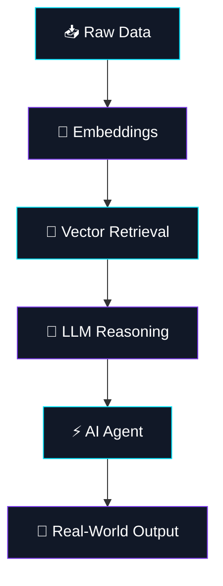

 <div align="center">

<!-- ANIMATED CYBERPUNK HEADER -->


<br/>

<a href="https://github.com/Vamshi192004">
  
</a>


</div>

---

## `> WHOAMI`

```python
class VamshiKrishna:
    def __init__(self):
        self.role = "AI / ML Engineer"
        self.location = "India 🇮🇳"
        self.mission = "Build AI that solves real problems"

        self.specialties = [
            "Large Language Models",
            "Retrieval-Augmented Generation",
            "Agentic AI",
            "Applied Machine Learning",
            "AI System Design"
        ]

        self.current_interests = [
            "Multi-Agent Architectures",
            "LLM Infrastructure",
            "Open Source",
            "Production-Ready AI"
        ]

    def philosophy(self):
        return "Great AI is more than a model. It's a system."

    def build(self):
        return "Imagine → Engineer → Deploy → Improve"


me = VamshiKrishna()
print(me.philosophy())
```

<div align="center">

### ⚡ `I DON'T JUST USE AI. I BUILD SYSTEMS AROUND IT.`

*From embeddings to intelligent agents — engineering ideas into working systems.*

</div>

---

## `> TECH_STACK --all`

<div align="center">

### 🧠 Artificial Intelligence & Machine Learning


### 💻 Languages & Development


### 🗄️ Data & Databases


</div>

---

## `> EXPERIENCE --verbose`

<details open>

<br/>

- 🤖 Built an **LLM-powered e-commerce chatbot**.
- 🔎 Implemented intent classification and semantic search using **FAISS**.
- 🧩 Worked with embeddings, REST APIs, and AI application workflows.
- ⚙️ Focused on reliability, maintainability, and practical deployment considerations.

</details>
</div>

### ⚡ Featured Builds

<table>
<tr>
<td width="50%" valign="top">

### 🤖 Agentic Content Generation System

Multi-agent LLM workflows for orchestrating content generation and AI-driven tasks.

**Focus:** Agent orchestration · LLM workflows · Automation

</td>
<td width="50%" valign="top">

### 🧠 Knowledge-Based RAG Agent

A retrieval-augmented generation system that combines knowledge retrieval with LLM responses.

**Focus:** Embeddings · Vector search · Context retrieval

</td>
</tr>
<tr>
<td width="50%" valign="top">

### 🔗 LangChain Projects

Experiments with LLM-powered agents, tools, chains, and intelligent workflows.

**Focus:** Tool calling · Chains · Agent workflows

</td>
<td width="50%" valign="top">

### 🔬 AI-Powered Hyperspectral Imaging

Applied machine learning for food authentication using hyperspectral imaging.

**Focus:** Image analysis · Feature extraction · Classification

</td>
</tr>
<tr>
<td colspan="2" valign="top">

### 🎬 AI Video Captioning

An automated pipeline for generating captions from video content.

**Focus:** Computer vision · Video processing · AI-generated captions

</td>
</tr>
</table>

> **Note:** Replace `YOUR_AGENTIC_REPO` with your actual public repository name, and add real project URLs to each project once available. Remove the pinned project card if that repository doesn't exist.

---

## `> AI_LAB --system_architecture`

<div align="center">


### ⚡ From Raw Data to Intelligent Decisions



</div>

---

## `> SKILL_MATRIX --capabilities`

<div align="center">

| DOMAIN | CORE CAPABILITIES |
|:---|:---|
| 🧠 **LLM Engineering** | Prompt Engineering · Embeddings · RAG |
| 🤖 **Agentic AI** | Tool Calling · Multi-Agent Workflows |
| 🔍 **Information Retrieval** | FAISS · Semantic Search · Retrieval |
| 📊 **Machine Learning** | Classification · Feature Engineering · Model Evaluation |
| 🛠️ **Backend Engineering** | Python · REST APIs · FastAPI |
| 🗄️ **Data Engineering** | Pandas · NumPy · SQL · MongoDB |

</div>

---

## `> BUILD_PROTOCOL --repeat`

<div align="center">


<br/>


</div>


### 🌌 THINK BIG. BUILD INTELLIGENTLY. SHIP RELIABLY.


<a href="https://github.com/Vamshi192004">

</a>

<br/>


</div>
